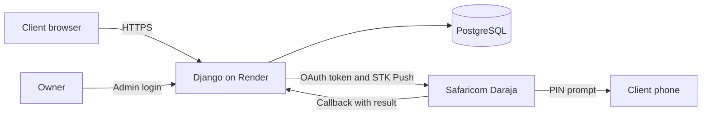
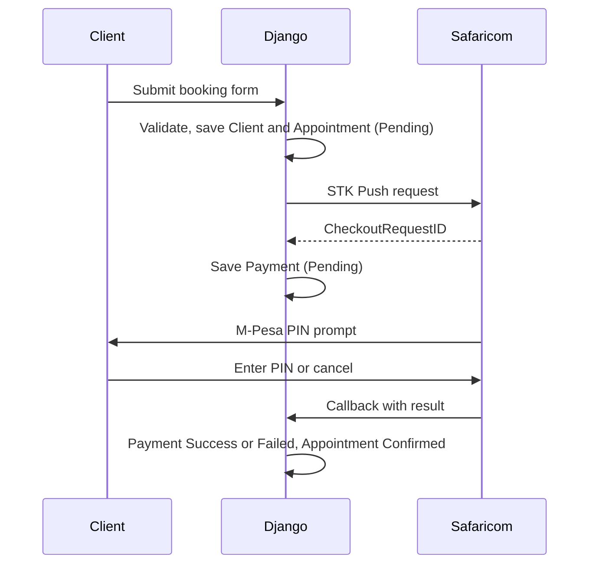

# Advance Choice Booking

Online booking and M-Pesa deposits for Advance Choice Ltd, an aesthetics clinic in Nairobi.

**Live:** https://booking-app-v63a.onrender.com
(Free hosting: the first visit after 15 idle minutes takes about a minute to wake up.)

## The problem

Clients booked by phone or WhatsApp. There was no record of who came for what, no client history, and deposits were collected by hand, so no-shows cost the clinic money.

## What it does

- **Clients** pick a service, date and time, and pay a deposit with an M-Pesa prompt on their phone.
- **The owner** logs in to a dashboard to see every client, their full appointment and payment history, and today's bookings.
- **Payments confirm themselves:** when Safaricom reports a successful payment, the booking moves from Pending to Confirmed with no manual step.

## Tech stack

| Layer | Choice | Why |
| --- | --- | --- |
| Back end | Python, Django 6 | Built-in admin, ORM and security features |
| Front end | Django templates, Tailwind CSS | Server-rendered pages; fast to build, works on any phone |
| Database | PostgreSQL (SQLite locally) | Relational data: clients, appointments, payments |
| Payments | Safaricom Daraja API (M-Pesa Express / STK Push), sandbox | How Kenyan clients actually pay |
| Hosting | Render (gunicorn, WhiteNoise) | HTTPS and Git-based deploys out of the box |

## Architecture



## Payment flow



## Data model

- **Client**: name, phone (unique), email
- **Service**: name, price, duration
- **Appointment**: client, service, start time, status (Pending, Confirmed, Completed, Cancelled)
- **Payment**: appointment, amount, phone, Safaricom CheckoutRequestID (unique), M-Pesa receipt, status

Records use `on_delete=PROTECT`, so a client or appointment with history can't be deleted by accident.

## Security

| Threat | Defence |
| --- | --- |
| SQL injection | Django ORM, parameterised queries |
| XSS | Template auto-escaping |
| CSRF | CSRF tokens on every form |
| Guessable URLs (IDOR) | Confirmation pages use signed, expiring tokens instead of database IDs |
| Bad input | Server-side validation of phone numbers and dates |
| Fake payment callbacks | Secret callback URL, constant-time comparison, amount check |
| Duplicate callbacks | Only Pending payments are updated (idempotent), inside a database transaction with a row lock |
| Faked payments by staff | Payments are read-only in the admin |
| Leaked secrets | All keys in environment variables, never in Git |
| Debug leaks | `DEBUG` off in production; HTTPS forced; secure cookies; HSTS |

## Run it locally (Windows)

```
git clone https://github.com/kimurgorNgetich/booking-app.git
cd booking-app
python -m venv venv
.\venv\Scripts\Activate.ps1
python -m pip install -r requirements.txt
copy .env.example .env
python manage.py migrate
python manage.py createsuperuser
python manage.py runserver
```

Fill in `.env` with your own Daraja sandbox credentials and a new Django secret key. Open http://127.0.0.1:8000 for the booking page and /admin for the dashboard.

## Lessons from building it

- **A payment callback was silently lost.** Payments stayed Pending. Access logs showed Safaricom's callback receiving a 301: Django was redirecting the URL to add a trailing slash, and Safaricom doesn't follow redirects on POST. Fixed in configuration, confirmed by a 200 in the logs.
- **Third-party failures shouldn't break bookings.** The appointment is saved before M-Pesa is called, so a Safaricom outage still leaves the clinic with the booking.

## Known limits and next steps

- **Reconciliation job:** callbacks can be lost, so a scheduled task should query Daraja's STK status API for payments still Pending after a few minutes.
- **Move to AWS:** Elastic Beanstalk or ECS for the app, RDS for PostgreSQL, Secrets Manager for keys, CloudWatch for logs.
- **Background tasks:** the STK Push runs inside the web request; it should move to a task queue.
- **Automated tests** for the form validation and the callback.
- SMS reminders, client accounts and self-service cancellation.
- Live M-Pesa (production) needs the clinic's own paybill or till number.

## Author

Levi Joel Kimurgor, BSc Computer Science, Kabarak University.
GitHub: [kimurgorNgetich](https://github.com/kimurgorNgetich)
